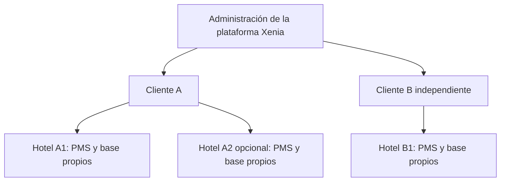

# Modelo de Xenia para clientes independientes

Decisión de producto confirmada por Marcelo el **23/11/2026**. El objetivo es aceptado; las ampliaciones de arquitectura enumeradas como próximas son **diseño para implementar**. Este documento no cambia permisos ni mueve datos.

## Producto y límites de cada cliente

Xenia es un mismo producto ofrecido a distintos clientes. Cada cliente tiene su configuración y personal; puede administrar un hotel o varios. Los informes consolidados sólo agregan establecimientos autorizados del mismo ámbito. Compartir plataforma no comparte huéspedes, saldos, archivos, credenciales, conversaciones ni acceso de soporte.

El diagrama representa la organización objetivo. La administración delegada de A y B y el alta genérica todavía no están implementadas en las referencias QA aceptadas.

## Conceptos que deben permanecer distintos

| Concepto | Significado |
| --- | --- |
| Cliente / organización | Relación comercial y frontera de administración del personal. En el catálogo actual existe `organizations`, con ID y nombre. |
| Hotel / establecimiento | Unidad operativa con membresías, configuración y datos propios. En el catálogo actual es `propertyId`. |
| Instalación del PMS | Servicio, dominio e identidad que sirven al hotel. El `clientId` actual identifica esta conexión autenticada; **no es el ID del cliente comercial**. |
| Usuario | Identidad de una persona. Su existencia no le concede acceso a hoteles u organizaciones. |
| Membresía | Relación autorizada con un cliente o un hotel y un rol concreto. No se infiere por correo, nombre, dominio ni texto del chat. |
| Entidad fiscal | Emisor y configuración fiscal; no se deduce automáticamente del cliente o del hotel. |
| Versión instalada | Código, esquema, configuración y fecha efectiva de cada servicio. Un nombre de rama o un merge no prueban lo servido. |

## Administración y permisos objetivo

| Perfil | Alcance previsto | Situación actual |
| --- | --- | --- |
| Administración de Xenia | Catálogo, instalaciones, módulos contratados, versiones, estado y soporte trazable. | Existe administración global; hoy también obtiene acceso operativo general mediante el rol `owner`. Separar este privilegio del administrador de cliente es trabajo pendiente. |
| Administrador de cliente | Gestiona su personal y asigna acceso sólo a hoteles propios. | No existe todavía como autoridad delegada de organización. El rol técnico propuesto es `customer_admin`; su contrato requiere implementación y pruebas. |
| Responsable de hotel | Configuración y operación de los hoteles asignados. | Existe el rol por establecimiento `manager`; no administra usuarios globales. |
| Recepción | Operaciones autorizadas de su hotel. | Probado en QA por servidor, pruebas y confirmación de Marcelo. |
| Sólo consulta | Lecturas autorizadas sin modificaciones. | Probado en QA con rechazo de escrituras y retirada de acceso reportados por Marcelo. |

El diseño de acceso de soporte debe pedir un alcance explícito, motivo, duración y auditoría para consultar datos operativos de otro cliente. No se presenta como una función que ya existe. Mantener una cuenta técnica global durante la transición no la convierte en una cuenta que debamos entregar a cada hotel.

## Qué conserva y qué amplía el diseño

**Se conserva:** identidad central, enlace autenticado con cada PMS, comprobación de instalación/base, membresías por hotel, separación de bases, permisos y pruebas QA aceptadas. No se reasignan Aurora o Brisa a otro cliente ni se cambian sus identificadores como parte de esta organización.

**Se amplía:** membresía administrativa de organización; autorización central de cada acción sobre usuarios y hoteles; listados que no revelen usuarios de otras organizaciones; alta y preparación genéricas; registro de versiones y ciclo de vida por instalación. Asignar un `organizationId` a una fila no implementa por sí solo todo este límite.

Cada petición debe resolver actor, cliente, hotel e instalación en el servidor. Un ID manipulado o un campo `platformAdmin`, rol u organización enviado desde el navegador no concede autoridad. La gestión de usuarios de cliente no reutiliza sin restricciones el listado global actual.

Una identidad puede colaborar con más de un cliente únicamente mediante accesos explícitos y comprobados. Agregarla a un cliente no debe importar sus hoteles, personal o datos del otro. Los cambios de rol y las retiradas de acceso deben volver a validarse también sobre sesiones ya abiertas.

## Datos e instalaciones

Se mantiene inicialmente **una base operativa por hotel** y una instalación separada cuando facilite el aislamiento. El producto evoluciona en una base común de código y versiones controladas, sin una copia permanente diferente por dueño.

Las bases `xenia-aurora-db` y `xenia-brisa-db` son demostraciones del panel anterior; `xenia-aurora-pms-db` y `xenia-brisa-pms-db` sirven a los PMS completos QA. El diseño futuro debe vincular el catálogo al PMS operativo sin exigir una segunda base de reservas de demostración a cada cliente. La transición conserva las bases actuales hasta revisar por separado cualquier retiro.

El alta nueva debe recibir configuración permitida y datos iniciales limpios, sin depender de los nombres Aurora/Brisa ni importar semillas operativas de Maran. Las credenciales permanecen en el proveedor y los servicios; una ficha de cliente no contiene sus valores.

La recuperación, exportación y baja tienen alcance por cliente/hotel y una política de conservación definida. El alta o la baja comercial no autoriza borrar datos históricos automáticamente.

## Versiones y operación

Actualmente las líneas del PMS QA, el asistente y `main` son distintas. La base común de producto es un objetivo de integración revisada, no un hecho cerrado. Cada integración conserva correcciones, contratos, migraciones y pruebas por módulo; no se fusionan ramas completas sólo por llamarse Xenia.

Las instalaciones QA ya aceptadas pueden conservar su rama durante esta documentación. Para clientes operativos se necesita una promoción controlada por versión identificable, con destino, preparación de esquema, comprobación, seguimiento y reversión. No se conecta una rama de planificación a sus servicios.

El modo actual `XENIA_PMS_MODE=qa` y sus restricciones no se convierten en un perfil comercial cambiando una variable. Se deben resolver arranque genérico, fiscalidad e integraciones configurables, permisos, recuperación y disponibilidad para ese perfil.

La verificación central por petición sigue vigente en QA. Diseñar continuidad con vencimientos y revocaciones definidos es un trabajo independiente; no se elimina el control actual para aparentar disponibilidad. No se han realizado pruebas de capacidad para afirmar cuántos hoteles soporta el despliegue.

## Papel del asistente

El piloto actual permanece en servicios y código propios. Su incorporación al producto multicliente debe transportar el ámbito verificado de cliente/hotel, separar casos, archivos, presupuestos y aprobaciones, y comprobar la revocación de acceso. No se le concede acceso operativo global por estar alojado junto al PMS.

Los mensajes libres no autorizan herramientas. Toda decisión ejecutable debe estar vinculada en el servidor con actor, alcance, caso, reporte, revisión e identidad. Preparar una propuesta no equivale a crear un diff real, ejecutar sus pruebas ni publicarlo.

El presupuesto y la evaluación de cada ensayo conservan su autorización concreta. El tope del piloto no acredita una nueva tanda formal ni permite sumar automáticamente cupos entre clientes.

## Referencias de código observadas

Lectura sobre `4a1f71ba4085ba1cff4d89c99bcb2de0a2e5d61f`: `server/xenia-control/store.ts` (organizaciones, propiedades y autorización global), `server/xenia-control/pms.ts` (identidad de instalación), `server/xenia-pms/binding.ts` (marca de base), `server/xenia-pms/runtime.ts` (sesiones y rutas), `shared/xeniaPms.ts` (roles y recursos) y `server/xenia-pms/config.ts` (plantillas y modo QA). Las ampliaciones citadas no aparecen implementadas por escribir este documento.
